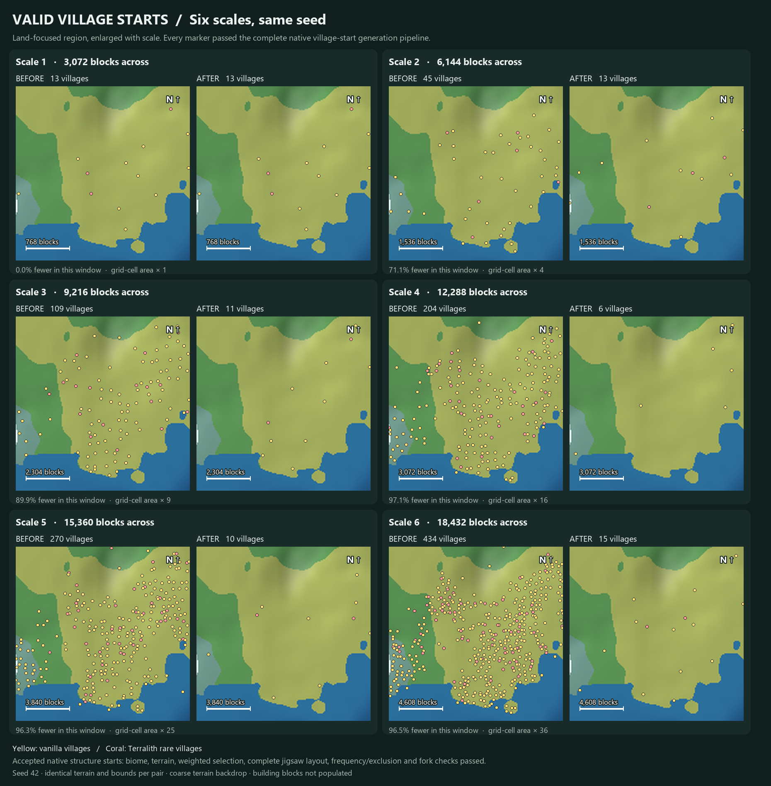

# Village spacing and terrain scale

Village candidate grids scale with terrain in new Terrain Diffusion worlds.
Spacing and separation are multiplied by the world's scale; scale 1 retains
the original placement. For example, a 34-chunk spacing becomes 136 chunks at scale 4.
Village sizes remain unchanged. Biome and terrain checks still decide which candidates
become villages, so accepted village counts need not be identical across scales.

## Datapacks

The `terrain-diffusion-mc:scale_with_terrain` structure-set tag includes vanilla villages,
ocean monuments and optional Terralith rare villages. Datapacks can extend or replace it. Only standard
random-spread placements are scaled; custom placement subclasses and stronghold rings
retain their definitions. Custom grids are capped at the codec's 4096-chunk spacing
limit, preserving the separation ratio. Generation, locate and exclusion queries share
per-generator copies, leaving registry definitions unchanged.

## Validation

The survey uses the same seed and corresponding land region at each scale. Markers
are accepted native starts after biome, terrain, exclusion and complete jigsaw checks;
the survey does not populate building blocks.
